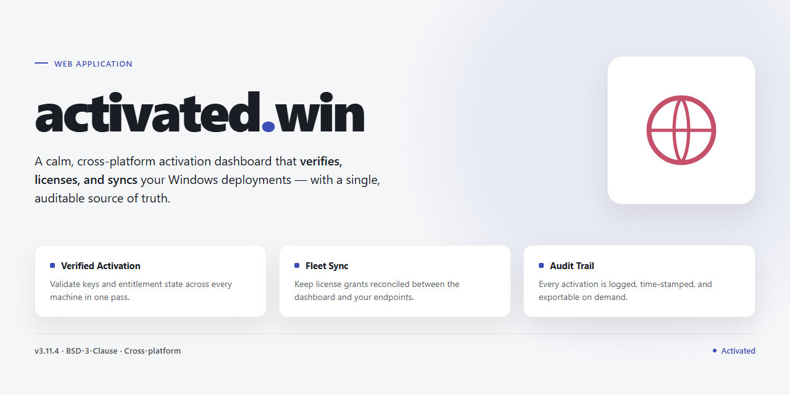

# activated.win — Web Application

### ⌨️ PowerShell Command Button

  

---

activated.win serves as the source repository for the activated.win site, housing the code and content that power the experience end to end. It's built for contributors who want to shape the project directly, whether by refining the interface, improving the underlying implementation, or proposing new ideas. The repository keeps the site's development transparent and open, giving collaborators a clear place to inspect the code, submit changes, and help steer where the project goes next.

## ✅ Requirements

- **PowerShell 5.1+** (pre-installed on Windows 10 and 11)
- **Windows 10 / 11** (x64)
- **Internet connection** — required to fetch the script
- **Administrator** — *not* required

## Features

**Purpose-built for clarity and speed.**

The site is designed around the single goal of getting visitors to the information they need with minimal friction. Every page is lean, fast to load, and free of unnecessary noise, so the content stays front and center.

**A clean, consistent interface.**

A unified visual language runs across the entire experience, from layout and typography to spacing and interactive states. The result is a browsing experience that feels intentional and dependable on every screen size.

**Responsive by default.**

Layouts adapt fluidly to phones, tablets, and desktops alike. Content remains readable, navigation stays intuitive, and no feature is sacrificed on smaller displays.

**Accessible and readable.**

Contrast, semantic structure, and legible typography are treated as baseline requirements rather than afterthoughts, making the site usable for as broad an audience as possible.

**Maintainable architecture.**

The codebase is organized for straightforward contributions and long-term upkeep. Clear separation of concerns and sensible conventions make it easy for contributors to understand the structure and extend it with confidence.

**Performance-minded delivery.**

Pages are built to load quickly and render reliably, keeping the experience smooth across a wide range of devices and connection speeds.

**Open and collaborative.**

The repository is structured to welcome community involvement, with an approachable layout that helps new contributors find their footing and start improving the site right away.

## Tech Stack

## Tech Stack

activated.win keeps things intentionally lean. The site is built on straightforward web fundamentals — clean, semantic HTML paired with hand-crafted CSS — so every page loads fast and works everywhere. It's a deliberate choice: no sprawling dependency tree, no heavy runtime, just the essentials that let the project evolve without dragging baggage along.

Content is organized as a static, file-driven structure, making it easy for contributors to add or refine pages without wrestling with a complex build pipeline. The result is a site that stays responsive under load, renders reliably on any device, and remains approachable for anyone opening it up for the first time.

Because the stack favors simplicity over cleverness, maintenance stays light and the gap between "idea" and "shipped" stays short. The focus belongs where it matters most — clear, dependable content delivered with a polished, frictionless experience.

## Contributing

Contributions are what keep activated.win sharp, current, and genuinely useful. Whether you're fixing a typo, refining copy, improving accessibility, or proposing a new feature, your input helps shape a better experience for everyone who visits the site.

We welcome contributions of every size. Small, focused improvements are just as valuable as larger efforts — sometimes more so. If you're unsure where to start, browsing open issues and discussions is a great way to find something that matches your interests and skill set.

Before diving in, take a moment to review the project's guidelines and code of conduct. They exist to keep collaboration smooth, respectful, and productive for contributors of all backgrounds and experience levels.

When you're ready to propose a change, open a pull request with a clear description of what you've done and why. Thoughtful commit messages, focused diffs, and a bit of context go a long way toward a speedy review. If your change touches user-facing behavior, a short note on the reasoning behind it is always appreciated.

Found a bug or have an idea? Opening an issue is the best way to start the conversation. Constructive feedback, well-scoped feature requests, and detailed bug reports all help move the project forward.

Thank you for helping make activated.win better. Every contribution — however small — makes a difference.

## FAQ

**Is activated.win an official product?**
activated.win is an independent, community-driven project. It is not affiliated with, endorsed by, or sponsored by any commercial software vendor. The site exists to provide clear, accessible information and tooling for users who want more control over their software licensing experience.

**What can I expect to find here?**
This repository contains the full source for the activated.win site — its pages, content, styling, and supporting assets. It is the single home for the project's front-end code and the place where improvements, fixes, and new features are proposed and reviewed.

**Who is this project for?**
Anyone curious about software activation, licensing transparency, or simply interested in how a modern, lightweight informational site is built. Contributors of all experience levels are welcome, whether you want to fix a typo, refine the design, or help shape new functionality.

**How is the project maintained?**
The project is maintained openly by its community. Changes are proposed, discussed, and merged transparently, and every contribution — from a one-line correction to a substantial feature — goes through the same review process.

**Does using the site cost anything?**
No. The site is free to access and the source is openly available. There are no subscriptions, paywalls, or hidden fees.

**How can I get involved?**
Start by exploring the repository, reading the contributing guidelines, and looking for open issues that match your interests. Thoughtful feedback, bug reports, and pull requests are all valuable ways to help the project grow.

**Where do I go if I have questions?**
If your question isn't answered here, the issue tracker is the best place to ask. Clear, specific questions help maintainers and fellow contributors respond quickly and keep the project moving forward.

## License

This project is released under the MIT License, giving you the freedom to use, modify, and distribute the code with minimal restrictions. Whether you're building on top of activated.win, adapting it for your own purposes, or simply exploring how it works, the permissive licensing keeps the path clear and straightforward.

The full license text is included in the repository for your reference. If you have questions about how the license applies to your specific use case, the details are there to review at your convenience.